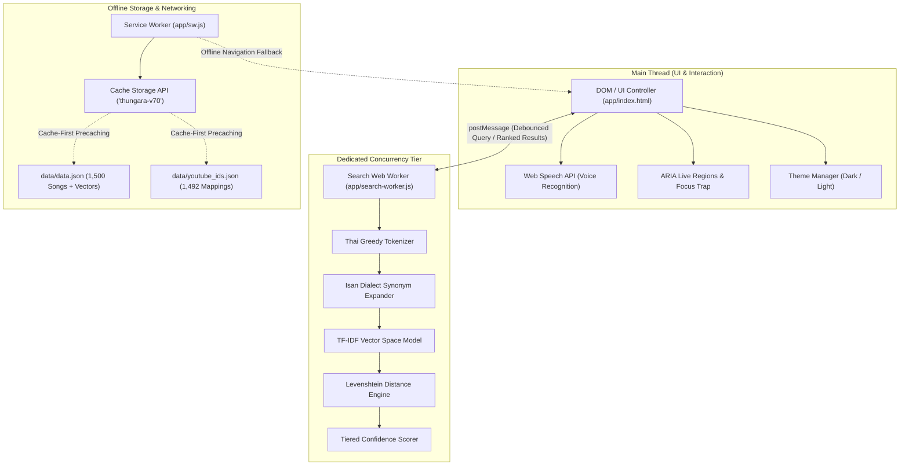
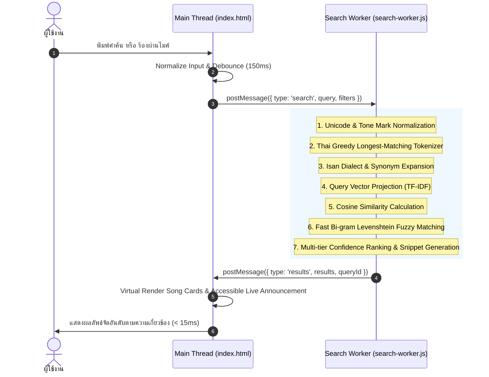

# สถาปัตยกรรมระบบ Thungara (System Architecture) 🏛️

เอกสารฉบับนี้อธิบายโครงสร้างเชิงวิศวกรรม, ลำดับการประมวลผลการค้นหา (Search Pipeline), สถาปัตยกรรมมัลติเธรด (Web Worker Concurrency), กลยุทธ์การทำงานแบบออฟไลน์ (PWA Offline Caching), และระบบทดสอบอัตโนมัติ (Automated Quality Assurance Harness) ของ **Thungara (ทุ่งคารา)**

---

## 1. ปรัชญาและหลักการออกแบบ (Core Philosophy)

1. **Pure Vanilla JS — Zero External Dependencies**:
   - ไม่พึ่งพา Framework หรือไลบรารีภายนอกแม้แต่ตัวเดียว (`dependencies: {}`, `devDependencies: {}`)
   - รันได้ทันทีบนเว็บเบราว์เซอร์มาตรฐานสมัยใหม่ทุกรุ่น
2. **In-Browser Real-Time Processing (< 15ms)**:
   - ประมวลผลดัชนี TF-IDF และการคำนวณเวกเตอร์ทั้งหมดในหน่วยความจำ (In-Memory) บนเบราว์เซอร์ฝั่งไคลเอนต์ 100%
   - ไม่มีการส่งคำค้นหาหรือเนื้อร้องกลับไปยังเซิร์ฟเวอร์ (Zero Backend Latency / 100% Privacy)
3. **PWA & Offline-First**:
   - ติดตั้งบนสมาร์ตโฟนและคอมพิวเตอร์ได้เสมือน Native Application
   - ใช้งานค้นหาและอ่านเนื้อร้องได้สมบูรณ์แม้ไม่มีสัญญาณอินเทอร์เน็ต
4. **Universal Accessibility (WCAG 2.1 AA)**:
   - ออกแบบรองรับ Keyboard Navigation, Screen Reader (A11y 100%), และค่า Contrast Ratio ระดับ AAA

---

## 2. แผนภาพสถาปัตยกรรมระดับสูง (High-Level Architecture)

---

## 3. ลำดับขั้นตอนการประมวลผลการค้นหา (Search Pipeline)

เมื่อผู้ใช้พิมพ์ข้อความหรือร้องเพลงผ่านไมโครโฟน ข้อมูลจะถูกประมวลผลผ่านลำดับขั้น 7 ระดับ:

### รายละเอียดแต่ละขั้นตอน:
1. **Unicode & Normalization**: ล้างอักขระพิเศษ, ปรับรูปวรรณยุกต์และสระภาษาไทยที่ซ้อนกันให้เป็นมาตรฐาน
2. **Thai Greedy Tokenizer**: ตัดคำภาษาไทยแบบ Longest Matching เทียบกับคลังคำศัพท์ 6,621 คำใน `data.vocab`
3. **Isan Dialect Synonyms**: ขยายคำพ้องความหมายภาษาถิ่นอีสาน เช่น "คิดถึง" $\leftrightarrow$ "คิดฮอด", "รัก" $\leftrightarrow$ "ฮัก", "ไม่" $\leftrightarrow$ "บ่"
4. **TF-IDF Vector Space Model**: แปลงชุด Token เป็น Sparse Vector และคำนวณ Cosine Similarity:
   $$\text{Sim}(q, d) = \frac{\vec{q} \cdot \vec{d}}{\|\vec{q}\| \|\vec{d}\|}$$
5. **Bi-gram Levenshtein Distance**: ตรวจจับคำสะกดผิด/คำเพี้ยน (Typo Tolerance) โดยใช้ Bi-gram Indexing เพื่อลดเวลาคำนวณจาก $O(N \cdot M)$ เหลือเพียงเสี้ยววินาที
6. **Tiered Confidence Scoring**: จัดลำดับคะแนนความเชื่อมั่นให้อยู่ในช่วง $[0.0, 1.0]$:
   - **Tier 1 (0.95 - 1.00)**: ตรงกับชื่อเพลง หรือชื่อศิลปินแบบเป๊ะ 100%
   - **Tier 2 (0.80 - 0.94)**: พบท่อนเนื้อร้องแบบวลีเต็ม (Exact Phrase)
   - **Tier 3 (0.50 - 0.79)**: พบคำพ้องเสียง/คำพ้องอีสาน และความคล้ายคลึงทางเวกเตอร์สูง
   - **Tier 4 (0.20 - 0.49)**: พบคำใกล้เคียงผ่าน Fuzzy Matching

---

## 4. สถาปัตยกรรมการทำงานแบบออฟไลน์ (Offline & PWA)

- **Service Worker Strategy**: ใช้กลยุทธ์ **Cache-First** สำหรับ Assets คงที่ (`data/data.json`, `app/search-worker.js`, ไอคอน)
- **Cache Name Versioning**: บริหารจัดการผ่านตัวแปร `CACHE_NAME` (เช่น `thungara-v70`) โดยใน Event `activate` จะล้างแคชเวอร์ชันเก่าทิ้งอัตโนมัติ
- **Navigation Fallback**: เมื่อผู้ใช้อยู่ในโหมด Offline และเรียก URL ใดๆ Service Worker จะส่ง `app/index.html` กลับมาเสมอ (Single Page Application Fallback)
- **HTTP Header Security**: เสริมความปลอดภัยด้วย `Content-Security-Policy` (CSP), `Permissions-Policy`, และ `Cache-Control: immutable` บน Production Hosting

---

## 5. โครงสร้างชุดทดสอบและวิศวกรรมคุณภาพ (Quality Harness)

ระบบได้รับการคุ้มกันด้วยชุดทดสอบอัตโนมัติ 7 มิติ (รันผ่าน `npm test`):

| ชุดการทดสอบ | ไฟล์ทดสอบ | จำนวนการตรวจสอบ | วัตถุประสงค์หลัก |
|:---|:---|:---:|:---|
| **1. Zero-Dependency Linter** | `tests/lint.js` | 24 Checks | ตรวจสอบ V8 Syntax, JSON Schemas, และความสะอาดของ Git |
| **2. Data & Vector Math Audit** | `tests/audit_data.js` | 17 Checks | ตรวจสอบความถูกต้องทางคณิตศาสตร์เวกเตอร์ TF-IDF และ YouTube IDs |
| **3. PWA & Offline Resilience** | `tests/test_pwa.js` | 16 Checks | ตรวจสอบสัญญา Precache, W3C Manifest, และ Service Worker Lifecycle |
| **4. WCAG 2.1 AA Accessibility** | `tests/audit_a11y.js` | 21 Checks | ตรวจสอบ ARIA Landmarks, Focus Trap, และ Contrast Ratio (AAA) |
| **5. Client Security & DOM-XSS** | `tests/audit_security.js` | 18 Checks | ตรวจสอบการห้ามใช้ eval, การ Escaping ทุกจุด, และความปลอดภัยลิงก์ |
| **6. Full-System Integrity Audit** | `tests/test_full_system.js` | 239 Checks | ตรวจสอบ Defensive Guards และความสมบูรณ์ทั้งระบบ |
| **7. Core Search Engine Benchmark** | `tests/test_search.js` | 176 Checks | ทดสอบความแม่นยำของระบบค้นหา 71 หมวดหมู่ |
| **Latency & Memory SLA** | `tests/benchmark.js` | 1,000 Queries | วัด p50-p99 Latency (< 15ms SLA) และตรวจสอบ Memory Leak |

---

## 6. สรุปภาพรวมเทคโนโลยี (Tech Stack Summary)

- **Frontend Core**: Pure Vanilla JavaScript (ES2022), HTML5, Modern CSS3 Custom Properties
- **Search Algorithm**: TF-IDF (Term Frequency-Inverse Document Frequency) + Vector Space Model + Cosine Similarity
- **Fuzzy Engine**: Dynamic Programming Levenshtein Distance with Fast Bi-gram Pruning
- **Speech Engine**: Web Speech API (`th-TH`)
- **Multithreading**: Dedicated Web Worker (`app/search-worker.js`)
- **Offline Engine**: Service Worker + Cache Storage API
- **Continuous Integration**: GitHub Actions Dual-Engine (Node.js 20 & Python 3.11)
